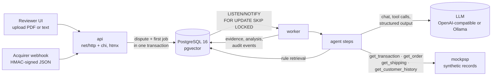
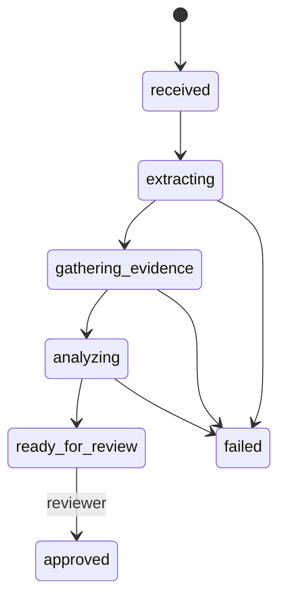

# Dispute Copilot

An AI agent that helps a merchant answer card chargebacks. It reads the dispute notice, pulls the evidence from the merchant's systems with tool calls, checks it against the rules for the reason code, recommends **fight** or **accept**, and drafts the response letter. A person reviews, edits and approves; nothing is ever submitted automatically.

Written in Go, with PostgreSQL (pgvector) as database, vector store and job queue. Runs with one Docker command.

> All data in this repository is synthetic: merchants, customers, cards, case numbers, transactions. Rule texts are short summaries I wrote for this project; they are not the card networks' rules.

## Why this problem

A chargeback takes the money back from the merchant first and asks questions later. The merchant loses the sale, the goods and a fee, and every dispute counts against their dispute ratio with the card networks. They can fight it, but only by sending the right evidence for that specific reason code before a deadline, usually 20 to 30 days. Most of that work is reading a notice, opening four internal systems and copying facts into a letter. Small teams often accept disputes they would win simply because they do not have time to build the case. That is the work this agent does, while keeping a human responsible for the decision.

## Demo

> Demo GIF placeholder: `docs/demo.gif` (upload a notice → agent works in the background → review → approve → download the package).

## Run in 1 command

You need Docker and an OpenAI API key (or any OpenAI-compatible API).

```bash
OPENAI_API_KEY=sk-... docker compose up --build
```

Open http://localhost:8080. The stack starts Postgres, runs the migrations, loads 15 synthetic disputes and the worker starts analysing them right away.

With a local model instead of an API key:

```bash
LLM_PROVIDER=ollama docker compose --profile ollama up --build
```

The first start downloads the Ollama image plus `qwen2.5:7b` and `nomic-embed-text` (about 8 GB in total). On a laptop CPU each dispute takes a few minutes.

Other useful commands:

```bash
make up            # same as the command above; asks for the key if it is not set
make seed          # load the synthetic disputes again (idempotent)
make eval          # run all scenarios and print accuracy, cost and latency
make test          # unit tests
make test-integration  # unit + integration tests against Postgres
make lint
```

Try it with the files in [`examples/`](examples): a PDF notice, a text notice and a webhook payload.

```bash
curl -X POST localhost:8080/api/v1/disputes --data-binary @examples/notice-visa-13.1.pdf

body=$(cat examples/webhook-visa-10.4.json)
sig=$(printf '%s' "$body" | openssl dgst -sha256 -hmac local-dev-secret | cut -d' ' -f2)
curl -X POST localhost:8080/api/v1/webhooks/disputes \
  -H "X-Signature: sha256=$sig" -H "Idempotency-Key: demo-1" -d "$body"
```

## Architecture



The API only validates input and stores it. Everything slow runs in the worker, one job per step. Each step saves its result, moves the status and queues the next job in the same transaction, so a crash between steps cannot lose work:



The queue is a `jobs` table. Workers claim jobs with `FOR UPDATE SKIP LOCKED` and hold a lease; if a worker dies, the lease expires and another worker takes the job. Delivery is at-least-once, so every step checks the dispute status first and does nothing if the work is already done. Temporary errors (rate limits, timeouts, 5xx) retry with backoff; errors that a retry will not fix (invalid model output, bad input) fail the dispute with a reason the reviewer can see.

### Code layout

```
cmd/
  api/        HTTP server: UI, JSON API, webhook
  worker/     queue worker that runs the agent
  mockpsp/    fake payment processor, order system, carrier and CRM
  seed/       loads the synthetic disputes through the API
  eval/       runs every scenario and scores the results
internal/
  domain/     types and rules with no dependencies (Money in minor units, statuses, policy)
  intake/     webhook parsing and signatures, PDF/text extraction, dedupe keys
  service/    use cases behind the HTTP layer (submit, review, approve)
  httpapi/    handlers, templates, static files
  pipeline/   one handler per step, wires the agent to the store
  agent/      extractor, tool loop, analyst, letter drafter, prompts, schemas
  rules/      rule library (markdown + front matter) and retrieval
  llm/        provider interface; openai/, ollama/, llmtest/ (scripted fake)
  queue/      worker pool, retries, backoff
  store/      PostgreSQL repositories, migrations, job queue SQL, vector search
  export/     evidence package as Markdown and PDF
  redact/     PII scrubbing for logs
  fixtures/   the 15 synthetic scenarios (records + expected labels)
```

## Agent design

**1. Extraction.** Structured webhooks are parsed in code; the model is not needed when the fields are already there. Text and PDF notices go to the model with a JSON schema. The answer is validated twice: against the schema, and then in code (the amount parses into minor units for its currency, dates are real dates, the network is Visa or Mastercard, the dispute is not opened before the purchase).

**2. Evidence with tools.** The model gets four tools and decides the order of the lookups. Guardrails around it:

- Only these four tools exist. Any other name is refused and logged.
- **ID scoping.** The model can only look up the disputed transaction, and after that only the order and customer IDs that appear in records it already received. A notice that says "also check customer cus_123" cannot make the agent read another customer's data.
- Tool calls from the same turn run in parallel (bounded `errgroup`), and results go back in order.
- A record that does not exist comes back as `not_found` and is kept as evidence of its own: the analysis has to say "missing evidence", not guess.
- **Backstop.** The model chooses the order, but it does not get to decide that the evidence is complete. If it stops early, the worker runs the remaining reachable lookups itself and marks them in the audit log. The eval reports how often that happens.

**3. Rules (RAG).** The rule library is a set of markdown files with front matter: reason code, category, a requirement checklist and the conditions to fight. Sections are embedded into pgvector. Retrieval is hybrid on purpose: the rule for the dispute is selected by metadata (network + reason code), because its checklist drives validation and must be exact; vector search adds the closest guidance sections and is the fallback when a reason code is not in the library.

**4. Analysis.** The model answers each requirement as `met`, `not_met` or `missing_evidence` and cites evidence by path, for example `shipping.proof.signed_by` or `customer_history.orders.0.device_id`. The validator rejects the answer if:

- a requirement is missing, repeated or not in the checklist,
- something is `met` without a citation,
- a citation points to a field that does not exist in the fetched records,
- a reason cites a rule section that was not retrieved.

The model gets the list of problems and one more try. If the second answer is still invalid, the step fails. A wrong answer never reaches the reviewer looking like a right one.

**5. Decision.** The final recommendation is not the model's opinion. Each rule declares when a dispute is worth fighting (for fraud: 3-D Secure authenticated, or AVS/CVV match plus an undisputed history on the same device). Code applies that policy to the model's requirement assessment. If the model's own recommendation disagrees, the policy wins and the UI flags it for the reviewer. There are no probability scores: the output is the checklist, the evidence and the rule.

**6. Letter.** Drafted only when the recommendation is fight, from the requirements that are met and their actual values. It must include the case number and must not contain a full card number, an email or an IP address; gaps are written as `[missing: ...]`.

**7. Human review.** The reviewer sees the evidence, the checklist with citations, the reasons and the letter. They can change the decision, edit the letter (edits are tracked), save a draft and approve. Approval locks the dispute. The package downloads as Markdown or PDF; submitting it to the acquirer stays a human action.

### Audit and observability

Every model call, tool call, guardrail intervention, status change, decision and human action is a row in `audit_events`: step, prompt version, model, tokens in/out, latency and a small detail object. Detail holds IDs and error codes only, never record contents. Prompts are versioned files (`extract.v1.txt`), so changing a prompt means adding a file, and the audit shows which version produced each answer.

Logs are JSON through `slog` with a redaction layer that drops sensitive keys and scrubs emails, IPs and anything that passes the Luhn check. Prometheus metrics on `/metrics` (api) and `:9090/metrics` (worker): job duration by step, model calls, tokens, latency, tool calls and guardrail events.

## Eval

`make eval` submits the 15 scenarios to the running stack, the same way real disputes arrive (JSON through the signed webhook, text notices as uploads), waits for the agent, and compares the result with the expected labels:

- **category**: reason category resolved from the notice,
- **decision**: fight or accept,
- **evidence recall**: records that exist for the dispute and were found,
- tokens, cost estimate, model time and end-to-end time per dispute.

| Scenarios | What they test |
|---|---|
| fraud (4 + 1) | 3DS authenticated; repeat customer on the same device; AVS mismatch on a new customer; digital gift card; order record missing |
| not received (4) | signed delivery; still in transit; delivered to another address; photo proof |
| not as described (2) | return label offered and unused; item returned but not refunded |
| duplicate (2) | two separate orders; same order captured twice |
| credit not processed (2) | refund already issued; return received and no refund |

8 of the 15 should be accepted. Seven of the notices are free text, so extraction is part of the test.

### Results

<!-- eval:start -->
Not run yet in this checkout. `make eval-report` runs the eval and writes the results table here.
<!-- eval:end -->

## Tests

- Unit tests for the domain (money, policy, evidence paths), intake, redaction, rule loading and retrieval, the provider clients (against `httptest` servers), the queue, the services and the HTTP handlers.
- Agent tests with a scripted fake model: tool guardrails and the backstop, retry on invalid output, rejection of invented citations, policy override.
- Integration test of the whole pipeline against real Postgres + pgvector with the fake model: webhook and text disputes go from `received` to `ready_for_review`, a broken notice fails after exactly one retry, a duplicate delivery is ignored, the reviewer approves, and the package is exported. Store tests check that concurrent workers never claim the same job and that expired leases are picked up again.

CI runs golangci-lint, the tests with the race detector against a pgvector service container, and the Docker build.

## Configuration

| Variable | Default | |
|---|---|---|
| `OPENAI_API_KEY` | | Enables the OpenAI provider |
| `LLM_PROVIDER` | `openai` if a key is set | `openai` or `ollama` |
| `LLM_MODEL` | `gpt-4.1-mini` / `qwen2.5:7b` | |
| `LLM_BASE_URL` | OpenAI / Ollama URL | Any OpenAI-compatible endpoint |
| `LLM_JSON_MODE` | `json_schema` | `json_object` for servers without schema support |
| `EMBED_PROVIDER` | same as LLM | `openai`, `ollama` or `hash` (offline, weaker) |
| `WEBHOOK_SECRET` | `local-dev-secret` in compose | HMAC-SHA256 secret for `X-Signature` |
| `WORKER_CONCURRENCY` | `4` | Jobs in parallel per worker |
| `JOB_LEASE` | `15m` | How long a job is held before another worker may take it |
| `LLM_PRICE_INPUT_PER_MTOK`, `LLM_PRICE_OUTPUT_PER_MTOK` | known prices for common models | Only used for the cost estimate |

## Tradeoffs and what I would do at production scale

**Decisions I made on purpose**

- **Postgres for everything.** One database is the store, the vector index and the queue. Enqueueing the next job in the same transaction as the state change removes a whole class of bugs (a dual write to Redis or Kafka would need an outbox). The cost is throughput, which is not the bottleneck when every job waits seconds for a model.
- **No agent framework.** The tool loop and its guardrails are a few hundred lines of plain Go. I wanted every guardrail to be explicit and testable, and the provider interface is small enough to implement twice.
- **The policy decides, the model assesses.** The model is good at reading records against a requirement; it is not a good place to keep the business rule of when to fight. Keeping that in code makes the decision auditable and testable.
- **Validation over trust.** Schema plus reference checks catch most hallucinations cheaply. They do not prove that a cited field supports the claim; that is what the human review is for.

**Next steps for a real deployment**

- **Idempotency.** Deliveries are deduplicated by `Idempotency-Key` or content hash, and every step is idempotent. In production I would store idempotency keys with a TTL and the original response, and add an outbox for any outbound call (for example submitting evidence to a PSP).
- **Rate limits and cost control.** Today the client retries 429s with backoff and the worker caps concurrency. Next: a token bucket per provider and per tenant, a circuit breaker, a daily budget per merchant, and a queue ordered by `respond_by` so the closest deadlines go first.
- **Multi-tenant.** A `merchant_id` on every table with row-level security, per-tenant credentials for the merchant systems, per-tenant rule overrides and prompt versions, and tenant-scoped audit exports.
- **PSP integrations.** Replace `mockpsp` with adapters behind the same `Records` interface (Stripe, Adyen, Checkout.com), receive disputes from their webhooks, and after human approval submit the evidence through their APIs.
- **Security and data.** Reviewer authentication and roles (there is none in this demo), CSRF protection, encryption of evidence at rest, retention rules, and minimising what goes to the model (names and emails are not needed for most reason codes).
- **Operations.** OpenTelemetry traces across api → queue → model, lease heartbeats for very long jobs, an HNSW index once the rule library grows, and the eval running in CI on every prompt change with a fixed model version.

## License

MIT
